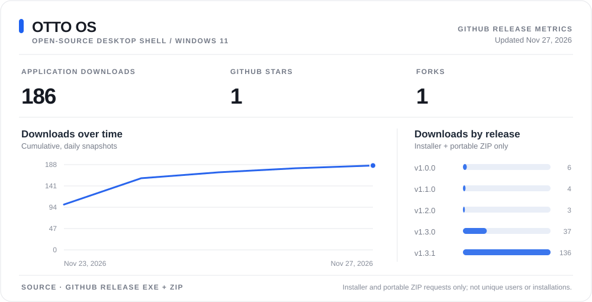

<div align="center">

  

  <h1>Otto OS</h1>

  <p><strong>Native macOS-inspired desktop shell for Windows 11 — Top Bar, Dynamic Island, Dock, Genie animations, Control Center, Focus Shield, and Liquid Glass in a single Rust binary.</strong></p>

  <p>
    <a href="https://github.com/howlil/otto-os/releases/latest">
      
    </a>
    <a href="https://github.com/howlil/otto-os/actions/workflows/ci.yml">
      
    </a>
    <a href="https://github.com/howlil/otto-os/releases">
      
    </a>
    
    <a href="LICENSE">
      
    </a>
  </p>

  <p>
    <a href="https://otto-os-landing.pages.dev">Website</a>
    &nbsp;·&nbsp;
    <a href="#download--installation">Download</a>
    &nbsp;·&nbsp;
    <a href="#features">Features</a>
    &nbsp;·&nbsp;
    <a href="#keyboard-shortcuts--recovery">Shortcuts &amp; Recovery</a>
    &nbsp;·&nbsp;
    <a href="#privacy-network--system-access">Privacy &amp; Safety</a>
    &nbsp;·&nbsp;
    <a href="#build-from-source">Build from Source</a>
    &nbsp;·&nbsp;
    <a href="CONTRIBUTING.md">Contributing</a>
  </p>

</div>

<!--
  VISUAL SHOWCASE SLOT — Drop screenshots/GIFs into docs/media/ (see docs/media/README.md)
  and uncomment the block below to display the hero showcase on GitHub.

<div align="center">
  
</div>

<details>
  <summary><strong>More screenshots &amp; demos</strong></summary>
  <br />
  <div align="center">
    
    <br /><br />
    
    
  </div>
</details>
-->

---

## Why Otto OS?

- **Pure Native Rust — Zero Electron or WebView**: Built directly on Win32, Direct2D, DirectWrite, Direct3D 11, DirectComposition, and GDI in a single lightweight process.
- **Modular & Reversible**: Top Bar, Notch, Dock, Window Controls, Genie, and Control Center can be toggled independently at runtime without restarting. Closing or uninstalling restores the Windows taskbar and work area automatically.
- **Local-First & Zero Telemetry**: No accounts, no cloud sync, no analytics, and no background telemetry. Optional network features are explicit and user-triggered.
- **Built for Everyday Safety**: Atomic config persistence, crash-safe shell recovery (`--restore-shell`), elevated/UIPI window awareness, and reduced-motion + Windows High Contrast fallbacks.

---

## Features

### Top Bar, Calendar & Notification Center
- Edge-to-edge menu bar reserving primary monitor work area via Windows `AppBar`, showing the brand menu, active application name, contextual menus (`File`, `Edit`, `View`, `Window`, `Help`), Tray overflow, Wi-Fi, Volume (wheel-scrollable), Battery, Search, Control Center, Notifications, and Date/Time.
- Configurable auto-hide modes (`Full Screen`, `Desktop`, `Always`, `Never`), per-item visibility toggles, optional bar background, and **Notch Stays Visible** mode.
- Interactive monthly **Calendar** popover and compact **Notification Center** with grouped cards, real app icons, and quick dismiss.

### Dynamic Island & Classic Notch
- Switch between **Classic Notch** and floating **Dynamic Island** with **Split Compact** dual-activity swapping (e.g. Focus timer + Now Playing circle side by side).
- **Focus & Screen Time (`Time` tab)**: Pomodoro, Quick Timer, and Stopwatch with cycle tracking, chimes, Today's screen time, Focus share ring, Top 3 Most Used apps, and a 7-day stacked usage chart.
- **Focus Shield & Distraction Blocking**: Non-destructive calm shield with a **Back** button over blocked apps and browser domains during Focus sessions (zero browser extension required; nothing is force-closed).
- **Media & Synced Lyrics**: Real album art via Windows GSMTC, interactive progress scrubber, adaptive cover accents, and an expandable auto-scrolling synced lyrics drawer (opt-in via LRCLIB).
- **Notch Productivity Tools**:
  - **Pocket**: Ephemeral 12-item drag-and-drop file/URL/text holding shelf.
  - **Clip**: RAM-only 12-item clipboard history that skips sensitive/concealed clipboard formats.
  - **Tasks (Quick Capture)**: Opt-in inline quick notes (`Ctrl+Alt+Q`) with in-place add/edit and active-task Focus subtitle.
  - **Privacy Indicators, Call Activity & System HUD**: Live camera/mic/location dots, active call indicator, and unified HUD for volume (suppressing duplicate Windows OSD), brightness, battery, Caps Lock, and Bluetooth devices.

### Floating Dock & GPU Genie Animations
- Floating bottom Dock with macOS squircle icons, cosine magnification, application grouping, drag-to-reorder and drag-out unpin, `WM_DROPFILES` onto apps or Trash, visual **Downloads** grid stack with active download progress, unread badges, and fast `$Recycle.Bin` state probing.
- Three exclusive modes: **Always Visible**, **Smart Auto-Hide**, and **Reserve Screen Space** (AppBar-backed).
- Hardware-accelerated DirectComposition **Genie** minimize/restore with hybrid GPU window capture and clean native fallback.

### Window Controls, Control Center, Spotlight & Settings
- **Window Controls**: Top-right macOS-style `[Minimize, Zoom/Maximize, Close]` caption overlay with titlebar gradient blending, press-capture semantics, Windows 11 rounded-corner enforcement, right-click **Window Tiling** menu, and `Alt+Click` window-group actions.
- **Control Center (`Ctrl+Alt+C`)**: Bento popover with Wi-Fi, Bluetooth, Focus, Battery, Audio Output Switcher with live peak metering, Display brightness (laptop LCD + external DDC/CI monitors), Sound slider, and Now Playing card.
- **Spotlight (`Ctrl+Alt+Space`)**: Instant local application search and full Apps catalog (`shell:AppsFolder` only — no background file indexing or web queries).
- **Material Appearance Engine**: 4 surface styles (**Liquid Glass**, **Frosted**, **Tinted**, **Solid**), 3 theme modes (**Auto**, **Light**, **Dark**), and 7 WCAG-calibrated accent colors with single low-power GPU composition.
- **Standalone Otto Settings (`Ctrl+Alt+,`)**: Dedicated Windows 11 Mica window managing all modules, Appearance, Focus blocklists/activity, Process & Memory Buffer Audit (3-tier safety classification, manual/auto **EcoQoS** Background Cleanup), and manual **in-app SHA-256 Software Updates**.

---

## Download & Installation

### System Requirements
- **Windows 11 22H2 or newer** (build `22621+`, `x64`). Windows 10 is unsupported and blocked cleanly at startup before any shell changes occur.

### Install Packages

Download the latest release from [**GitHub Releases**](https://github.com/howlil/otto-os/releases/latest):

| Distribution | File | Notes |
| --- | --- | --- |
| **Per-User Installer (Recommended)** | `otto-os-setup-<version>-x64.exe` | Installs to `%LOCALAPPDATA%\Programs\Otto OS`, **no UAC admin prompt required**, cleanly stops running instances on upgrade/uninstall. |
| **Portable ZIP** | `otto-os-<version>-windows-x64.zip` | Extract and run `otto-os.exe` directly. |
| **Checksums** | `SHA256SUMS.txt` | Verify binary integrity before running. |

> [!NOTE]
> **Windows SmartScreen Notice**: Public releases are currently **unsigned** while open-source code signing (SignPath / Azure Trusted Signing) is being established. Windows Defender SmartScreen may display *"Windows protected your PC"* on first launch. Verify the download against `SHA256SUMS.txt` before proceeding, or build directly from source below.

Verify checksum in PowerShell:

```powershell
Get-FileHash .\otto-os-setup-<version>-x64.exe -Algorithm SHA256
# Compare with the matching line in SHA256SUMS.txt from the same release
```

WinGet manifest templates (`howlil.OttoOS`) are generated with every release under `packaging/winget/` and attached to GitHub Releases.

---

## Project Growth

Otto OS stars, forks, and GitHub Release asset downloads, recorded daily. Download history begins with the first tracking run.

<p align="center">
  <a href="https://github.com/howlil/otto-os/releases">
    
  </a>
</p>

---

## Keyboard Shortcuts & Recovery

### Global Shortcuts

| Shortcut | Action | Scope |
| --- | --- | --- |
| `Ctrl+Alt+,` | Toggle **Otto Settings** | Always active (even if Top Bar or Global Hotkeys are off) |
| `Ctrl+Alt+B` | Toggle **Top Bar** on/off | Always active (shell recovery) |
| `Ctrl+Alt+D` | Toggle **Dock** on/off | Always active (shell recovery) |
| `Ctrl+Alt+C` | Toggle **Control Center** | Active when Global Hotkeys are enabled |
| `Ctrl+Alt+Space` | Toggle **Spotlight Search** | Active when Global Hotkeys are enabled |
| `Ctrl+Alt+N` | Toggle expanded **Notch** | Active when Global Hotkeys are enabled |
| `Ctrl+Alt+P` | Toggle **Pomodoro Focus** | Active when Global Hotkeys are enabled |
| `Ctrl+Alt+Q` | Open **Quick Capture** inline task composer | Active when Quick Capture and Global Hotkeys are enabled |
| `Ctrl+F2` | Focus **Top Bar** for keyboard navigation | Active when Global Hotkeys are enabled |

### Accessing Settings & Safe Shell Recovery

- **Windows System Tray**: Left-click the Otto OS tray icon to open **Otto Settings**; right-click for quick toggles, **Open Logs Folder**, or **Quit Otto OS**.
- **CLI lifecycle & recovery flags**:
  - `otto-os.exe --quit` — cleanly shuts down a running instance and restores the Windows taskbar and work area.
  - `otto-os.exe --restore-shell` — restores any saved taskbar state and desktop work area from `%LOCALAPPDATA%\otto-os\shell_recovery.json`.
  - `otto-os.exe --no-blur` — disables backdrop capture / Liquid Glass blur for troubleshooting or development.
  - `otto-os.exe --enable-plugin=<name>` / `--disable-plugin=<name>` — overrides plugin state at startup (`top_bar`, `dock`, `window_controls`, `genie`, `control_center`).

---

## Privacy, Network & System Access

Otto OS runs locally with **zero telemetry, zero analytics, and zero accounts**. Because a desktop shell interacts closely with Windows APIs, here is an exact breakdown of what Otto OS touches:

| Area | Behavior |
| --- | --- |
| **Outbound Network** | **Only 2 endpoints, both HTTPS-enforced and user-controlled**: (1) `api.github.com` / `github.com` solely when you click *Check for Updates* or *Install Update* in `Otto Settings → About`; (2) `lrclib.net` solely when you opt into *Online Synced Lyrics*. Zero background polling. |
| **Local Data** | Stored atomically in `%LOCALAPPDATA%\otto-os\` (`plugins.txt`, `pinned.txt`, `tasks.txt`, `focus_activity.txt`, `shell_recovery.json`, `hidden_windows.txt`, `lyrics_cache\`, and rolling logs in `logs\`). Debug builds use `%LOCALAPPDATA%\otto-os-dev\`. |
| **Clipboard (`Clip`)** | Held strictly in RAM (max 12 items), never written to disk or logs, and skips concealed/password-manager clipboard formats. |
| **Keyboard Hook (`WH_KEYBOARD_LL`)** | Used to intercept volume media keys for the unified Notch HUD, route bar keyboard navigation, and count non-injected keystrokes locally for Screen Time. Individual characters are never logged or stored. |
| **UI Automation (Focus Shield)** | Reads the active browser's address bar locally on a background thread to match domains against your Focus blocklist without a browser extension. |
| **Background Cleanup (Opt-in)** | Off by default. Uses Windows EcoQoS (`ProcessPowerThrottling`) on sustained non-foreground user apps only; never auto-terminates processes and locks OS-critical, service, shell, and elevated processes as protected. |
| **Screenshots / Screen Share** | When *Liquid Glass* capture is active, Otto windows set `WDA_EXCLUDEFROMCAPTURE` to avoid photographing themselves. Enable **Visible in Screenshots / Screen Share** in Settings when recording demos or sharing your screen. |

---

## Known Limitations & Non-Goals

- **Primary monitor only**: Top Bar, Dock, and AppBar work-area reservations operate on the primary monitor (`Shell_SecondaryTrayWnd` on secondary monitors is left intact).
- **Windows Notification Center & Notch Toast Alerts**: Windows restricts `UserNotificationListener` to apps with MSIX package identity. Unpacked `.exe`/ZIP builds degrade gracefully until the signed MSIX / Sparse Package lane ships.
- **Elevated (Administrator) windows**: When Otto runs unprivileged (default), Windows UIPI blocks overlaying or controlling elevated windows; Otto skips them cleanly so their native caption buttons keep working.
- **Explicit non-goals**: Apple ID / iCloud sync, AirDrop / AirPlay / Continuity Camera, Windows 10 support, macOS binary emulation, and system-audio-recording purple indicator (no reliable Windows API).

---

## Architecture

Otto OS is structured as a single-process modular monolith across four Rust crates with strictly enforced dependency boundaries:

```text
Windows monitor, shell, and input state
                 │
                 ▼
        otto-platform adapters
                 │
                 ▼
          otto-core values
                 │
                 ▼
        otto-os application state
                 │
       ┌─────────┴─────────┐
       ▼                   ▼
 otto-render          native actions
```

Dependency direction (enforced by automated architecture fitness tests in [`crates/app/src/host/fitness_tests.rs`](crates/app/src/host/fitness_tests.rs)):

```text
otto-os → otto-render → otto-core
otto-os → otto-platform → otto-core
```

| Crate | Responsibility |
| --- | --- |
| [`otto-core`](crates/core) | Pure, platform-independent domain models, layout & hit-testing, motion, glass math, capability ports, and unit tests. |
| [`otto-platform`](crates/platform) | Win32, COM, WinRT, AppBar, audio/DDC/CI, media, shell, hooks, persistence, updater, and diagnostics behind safe adapters. |
| [`otto-render`](crates/render) | Direct2D, DirectWrite, D3D11/HLSL shaders, DirectComposition, GDI surfaces, and explicit resource cleanup. |
| [`otto-os`](crates/app) | Process entry, `Host` lifecycle, plugin registry, message loop, timers, and feature controllers. |

Full system contracts and design guardrails live in [`.agents/engineering.md`](.agents/engineering.md) and [`.agents/DESIGN.md`](.agents/DESIGN.md).

---

## Build from Source

### Prerequisites
- Windows 11 22H2+ (`x64`) with an unlocked interactive desktop session for runtime/native tests.
- Rust toolchain matching [`rust-toolchain.toml`](rust-toolchain.toml) (Rust edition 2024, `x86_64-pc-windows-msvc`).
- Windows 10/11 SDK (provides `rc.exe` for application icon and manifest resources).

### Run & Verify

```powershell
git clone https://github.com/howlil/otto-os.git
cd otto-os

# Run locally (uses isolated %LOCALAPPDATA%\otto-os-dev)
cargo run -p otto-os

# Full verification gate (formatting, tests, check, clippy, E2E static checks)
.\scripts\gate.ps1
```

Or run individual checks:

```powershell
cargo fmt --all -- --check
cargo test --workspace -- --test-threads=1
cargo check --workspace
cargo clippy --workspace --all-targets --all-features -- -D warnings
```

<details>
  <summary><strong>Packaging, Smoke Tests &amp; Windows E2E Acceptance</strong></summary>

#### Per-user Windows installer (Inno Setup 6)

```powershell
.\packaging\installer\build.ps1
```

#### MSIX package (Microsoft Store lane)

```powershell
.\packaging\msix\build.ps1 `
  -IdentityName 'your-store-identity' `
  -Publisher 'CN=Your Publisher' `
  -PublisherDisplayName 'Your Publisher' `
  -Version '1.3.1.0' `
  -CertificatePath 'C:\path\to\publisher.pfx' `
  -CertificatePassword (Read-Host 'PFX password' -AsSecureString)
```

#### Startup/shutdown smoke test &amp; native Windows E2E

```powershell
.\packaging\msix\smoke-test.ps1 -ExecutablePath 'target\release\otto-os.exe'
.\tests\e2e\windows-e2e.ps1 -Scenario all
```

</details>

<details>
  <summary><strong>Configuration Reference (<code>%LOCALAPPDATA%\otto-os\plugins.txt</code>)</strong></summary>

Otto OS persists module activation and preferences atomically as versioned key-value lines:

```ini
version=1
enabled=popup_menu,top_bar,spotlight,dock,window_controls,genie,control_center
online_lyrics=false
dock_autohide=false
dock_reserve_space=false
dock_magnification=true
dock_icon_size=48
dock_hide_taskbar=true
dock_show_downloads=true
dock_show_trash=true
capture_visible=false
hotkeys_enabled=true
classic_logo=false
notch_enabled=true
dynamic_island=false
onboarding_seen=false
privacy_indicators=true
clipboard_history=true
drop_shelf=true
notch_hud=true
media_module=true
focus_module=true
background_cleanup=false
menu_bar_hide=full_screen
menu_bar_hidden=
menu_bar_background=true
menu_bar_keep_notch=false
quick_capture=false
appearance_style=liquid_glass
appearance_theme=auto
appearance_accent=system
```

Local rolling logs (max 512 KB + 1 backup, zero secrets/clipboard data) live in `%LOCALAPPDATA%\otto-os\logs\`.

</details>

---

## Contributing, Security & License

- **Contributing**: Read [`CONTRIBUTING.md`](CONTRIBUTING.md) before opening a pull request (note the crate boundary and comment-free Rust source rules enforced by tests).
- **Security**: To report a vulnerability privately, please follow [`SECURITY.md`](SECURITY.md).
- **Code of Conduct**: Participation is governed by [`CODE_OF_CONDUCT.md`](CODE_OF_CONDUCT.md).
- **Changelog**: Release history is maintained in [`CHANGELOG.md`](CHANGELOG.md).
- **License**: Distributed under the **MIT License**. See [`LICENSE`](LICENSE).

---

<sub>Otto OS is an independent open-source project and is not affiliated with, endorsed by, or sponsored by Apple Inc. or Microsoft Corporation.</sub>
